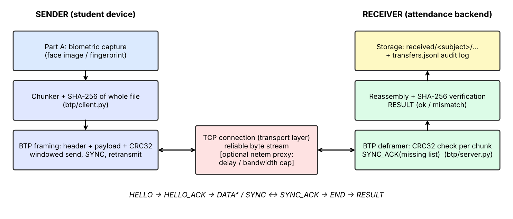

# BTP – Biometric Transfer Protocol (Computer Networks, Part B)

A custom **application-layer protocol running over TCP** that transfers the biometric data captured in Part A
(face image / fingerprint file) from a sender to a receiver, reconstructs it, and **verifies its integrity**.

* Python 3.8+ (3.10+ recommended), **standard library only** for the protocol itself
* Optional: `matplotlib` (benchmark plots), `opencv-python` (webcam capture helper)



## What the protocol does
| Mechanism | Where | Purpose |
|---|---|---|
| Framing (`magic, version, type, seq, length`) | `btp/protocol.py` | TCP is a byte stream – length field recovers message boundaries |
| Per-chunk CRC32 | `protocol.py` / `server.py` | detect corrupted chunks individually |
| Windowed send + SYNC / SYNC_ACK(missing list) | `client.py` / `server.py` | selective retransmission; window = flow-control/throughput knob |
| Whole-file SHA-256 | `client.py` / `server.py` | end-to-end integrity check of the reconstructed biometric file |
| Input validation (size caps, subject-id regex, filename sanitising, timeouts) | `server.py` | safe handling of a malicious/buggy peer |

Full spec: [`docs/protocol.md`](docs/protocol.md).

## Quick start (two terminals)
```bash
# 0) (optional) dummy biometric file if Part A output is not ready:  python tools/make_sample.py 200
# Terminal 1 – receiver
python -m btp.server --port 5000 --out received

# Terminal 2 – sender (use the file produced in Part A)
python -m btp.client --host 127.0.0.1 --port 5000 --file captured/face.jpg --subject student01 --modality face
```
Across two machines: run the server on one, use its LAN IP in `--host` (open TCP port 5000).

Demo of error recovery (inject 10 % corrupted chunks – the receiver detects them via CRC and requests retransmission):
```bash
python -m btp.client --file captured/face.jpg --corrupt-prob 0.10
```
Independent check: `python tools/verify_received.py captured/face.jpg received/student01/<stored file>`

Slow-link emulation (40 ms RTT) for the demo/experiments:
```bash
python -m btp.netem_proxy --listen-port 6000 --target-port 5000 --delay-ms 20
python -m btp.client --port 6000 --file captured/face.jpg --window 1    # stop-and-wait: slow
python -m btp.client --port 6000 --file captured/face.jpg --window 64   # pipelined: fast
```

## Large data (GBs of files)
Files are **streamed**: the sender reads chunks from disk, the receiver writes them straight to a temp file in
`received/.partial/` and only moves it into `received/<subject>/` after the SHA-256 matches. Memory use is constant,
and each file can be up to 32 GiB. Send a whole folder (one verified transfer per file, automatic retries, running total):
```bash
python -m btp.client --host <server-ip> --port 5000 --dir /path/to/biometric_data --subject student01
```
Defaults are `--chunk-size 65536 --window 64`, which suit bulk transfers. Tested: 20 files x 62 MB (1.24 GB) over localhost, all verified.
Over real Wi-Fi/LAN the link speed is the limit (3.5 GB at 100 Mbit/s is roughly 5 minutes) - this is a good extra experiment for the report.

## Tests and performance evaluation
```bash
python -m unittest discover -s tests -v        # 8 tests: bit-exact roundtrip, corruption, tampering, path traversal, garbage input...
pip install matplotlib
python benchmark/run_benchmark.py              # -> results/benchmark.csv + results/*.png  (--quick for a fast run)
python tools/make_architecture.py              # regenerates docs/architecture.png
```
Metrics measured: **transmission time, throughput, protocol overhead, retransmissions, success rate**.
Experiments: chunk-size sweep, window-size sweep on a 40 ms-RTT link, corruption-rate sweep.

## Wiring it to the Part A app
The sender only needs bytes. From Python:
```python
from btp.client import send_data
m = send_data("server-ip", 5000, open("face.jpg","rb").read(), "face.jpg", subject="student01", modality="face")
assert m["ok"]
```
Allowed modalities: `face, fingerprint, iris, voice, other`.

## Repo layout
```
btp/            protocol.py  server.py  client.py  netem_proxy.py
tools/          capture.py (webcam)  make_sample.py  verify_received.py  make_architecture.py
benchmark/      run_benchmark.py
tests/          test_btp.py
docs/           protocol.md  REPORT_TEMPLATE.md  VIVA_NOTES.md  architecture.png
results/        generated by the benchmark (CSV + plots)
```

## Security note
BTP gives **integrity against accidents**, not against an attacker (an attacker can recompute CRC/SHA).
Biometric data is sensitive: in a real deployment, wrap the socket in TLS (`ssl.create_default_context`) – the framing is unchanged.
